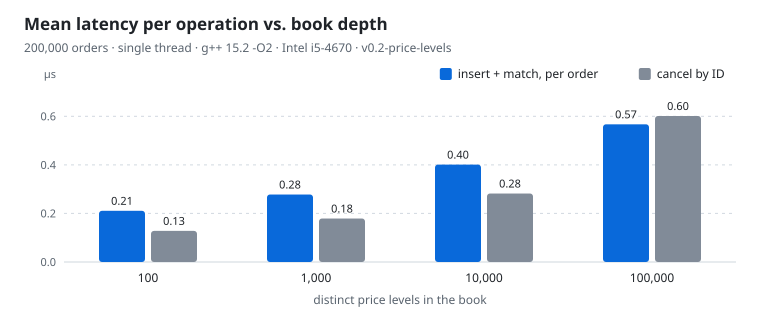

# Order Book & Matching Engine

A single-instrument limit order book with a matching engine, written in modern C++.
Built iteratively: every design decision is measured against a reproducible benchmark
before and after, and correctness is checked by unit scenarios and randomized invariants.
 
**Current version:** `v0.2.1-latency` (see [Version history](#version-history)).

## Features
 
- Price-time priority: best price first, then arrival order within a price level
- Order types: `GTC` (remainder rests in the book) and `IOC` (remainder is dropped);
  `FOK` is declared but **not implemented yet**
- Cancel by order ID
- Trades execute at the price of the resting order

## Build & Run
 
```bash
g++ -O2 -std=c++17 main.cpp order_book.cpp -o bench
g++ -O2 -std=c++17 bench_latency.cpp order_book.cpp -o latency

./bench --test                               # 5 deterministic scenarios, 35 checks
./bench <orders> <ioc%>                      # random flow, historical price model (101 levels)
./bench <orders> <ioc%> <levels> <aggr%>     # deep-book model (see Benchmarks)
taskset -c 2 ./latency <orders> <ioc%> <levels> <aggr%> <runs>   # see Latency per operation
```

Verbose output (submitted orders and trades) is printed automatically when `<orders> <= 20`.
 
Run under sanitizers (recommended after any change to the data structures):
 
```bash
g++ -O1 -g -std=c++17 -fsanitize=address,undefined main.cpp order_book.cpp -o bench_san
./bench_san --test && ./bench_san 20000 30 1000 10
```

## Design
 
| Structure | Type | Role |
|---|---|---|
| Sell side | `std::map<double, std::list<Order>>` | price levels, best ask = `begin()` |
| Buy side | `std::map<double, std::list<Order>>` | price levels, best bid = `rbegin()` |
| Index | `std::unordered_map<int, OrderLocation>` | order ID → (side, price, list iterator) |
 
- **Why `std::list` per level:** its iterators stay valid when other elements are inserted
  or erased, so an order can be removed in O(1) from a stored iterator without invalidating
  the index entries of the other orders.
- **Matching happens before insertion.** An incoming order is matched against the opposite
  side first; only the remaining quantity of a `GTC` order is inserted. An `IOC` remainder
  is discarded.
- **The matching loop re-reads the best level at every iteration** and never keeps an
  iterator across an erase.
- **One removal path** (`cancelOrder`) is used both for user cancels and for fully filled
  orders, so the price-level map and the index cannot get out of sync.

### Complexity
 
`N` = resting orders, `L` = distinct price levels.
 
| Operation | Time |
|---|---|
| Add an order that does not cross | O(log L) |
| Match | O(1) per trade + O(log L) per fully filled resting order |
| Cancel by ID | O(log L) (hash lookup and list erase are O(1); locating the level is O(log L)) |
| Space | O(N + L) |
 
## Correctness
 
- **Unit scenarios** (`--test`): non-crossing sell, cancel of an unknown / already cancelled
  ID and of a non-integer price, multi-level sweep with FIFO priority and partial fill,
  IOC remainder never resting, sell crossing several bids.
- **Randomized invariants**, checked after every benchmark run:
  - *Conservation*: for each side, `submitted = traded + resting + cancelled + dropped(IOC)`.
    With 0 % IOC the dropped quantity must be exactly 0.
  - *Index consistency*: the index holds exactly the orders present in the price levels.
  - *Idempotent cancel*: cancelling the same IDs twice leaves the book unchanged.

## Benchmarks (V2)

<picture>
  <source media="(prefers-color-scheme: dark)" srcset="docs/bench-dark.svg">
  
</picture>

**Method.** Single thread, `-O2`, `std::chrono`, fixed seed (42) so every run replays the
same order flow. Insertion and matching are measured together (matching happens on
arrival). Cancel timing covers only orders that are actually resting.
 
**Machine.** Linux x86-64, `g++ 15.2.0`, CPU `Intel(R) Core(TM) i5-4670 CPU @ 3.40GHz`.
 
**Deep-book workload** (`./bench 200000 0 <L> 5`): 200,000 orders, 0 % IOC. Passive buys
are placed below a mid price and passive sells above it (so they do not cross); 5 % of
orders are aggressive and cross the book. About 180,000 orders remain resting, and about
19,000 trades are executed per run.
 
| Price levels (L) | µs / order | Resting orders | Levels per side | µs / cancel |
|---:|---:|---:|---:|---:|
| 100 | 0.211 | 180,153 | 50 | 0.128 |
| 1,000 | 0.278 | 180,332 | 485 | 0.179 |
| 10,000 | 0.401 | 180,200 | ~4,760 | 0.282 |
| 100,000 | 0.567 | 180,350 | ~40,400 | 0.601 |
 
Conservation, index consistency and idempotent cancel hold on every run above.
 
**Reading the numbers.**
- The cost per order grows slowly with L (×2.7 for ×1000 more levels).
- The increment per decade of L is +0.07, +0.12, +0.17 µs. A pure O(log L) term would add a
  constant amount per decade, so growth beyond that is consistent with memory effects
  (more distinct nodes touched per operation). This is an inference, **not yet profiled**
  (`perf` / `cachegrind` are on the roadmap).
- Cancels degrade faster than inserts (×4.7): each cancel touches a hash node, a list node
  and a map node scattered in memory.
**Caveats.** One run per point. Synthetic, symmetric flow around a single mid price. Not
comparable with the `v0.1-naive` numbers (different price model, and matching then ran as
a batch pass after all insertions).

## Latency per operation

Measured with `bench_latency.cpp` and `latency.hpp`, a separate program (`main.cpp` is unchanged).
The measurement harness was written with an AI assistant; the order book it measures, the
scenarios and the runs are mine. Raw output: [`docs/latency-results.txt`](docs/latency-results.txt).

```bash
g++ -O2 -std=c++17 bench_latency.cpp order_book.cpp -o latency
taskset -c 2 ./latency <orders> <ioc%> <levels> <aggressive%> <runs>
```

**Method.** One `steady_clock` timestamp pair around each `addOrder` / `cancelOrder`. Samples go
into preallocated vectors, so nothing is allocated inside the timed region. One warm-up run is
discarded, then each percentile is the median across 5 runs; max is the worst sample across runs.
Same generator and seed (42) as the throughput benchmark. The timer costs 16 ns per pair on this
machine; it is included in every sample, not subtracted.

**Categories.** *Aggressive*: the order produced at least one trade. *No trade*: every other
order, i.e. GTC orders that rest in the book and IOC orders that did not cross (dropped without
being inserted). The raw output labels this category "Insertion passive". *Cancel*: one resting
order in three, cancelled after all insertions.

**Machine.** Intel Core i5-4670 @ 3.40 GHz, Linux x86-64, g++ 15.2.0, `-O2`, pinned to one core.

| # | Orders / IOC / levels / aggressive | Category | n | p50 (ns) | p99 (ns) | p99.9 (ns) | max (µs) |
|---|---|---|---:|---:|---:|---:|---:|
| 1 | 200k / 0 % / 50 / 5 % | No trade | 189,943 | 121 | 1,288 | 2,441 | 3,821 |
| | | Aggressive | 10,057 | 117 | 778 | 1,311 | 9.9 |
| | | Cancel | 60,032 | 112 | 319 | 498 | 10.1 |
| 2 | 200k / 20 % / 50 / 5 % | No trade | 189,976 | 122 | 248 | 440 | 2,109 |
| | | Aggressive | 10,024 | 124 | 826 | 1,299 | 10.9 |
| | | Cancel | 47,150 | 127 | 392 | 603 | 10.1 |
| 3 | 200k / 0 % / 500 / 5 % | No trade | 190,022 | 179 | 1,387 | 2,781 | 4,194 |
| | | Aggressive | 9,978 | 150 | 653 | 1,286 | 11.3 |
| | | Cancel | 60,091 | 142 | 370 | 574 | 31.4 |
| 4 | 200k / 0 % / 500 / 50 % | No trade | 114,452 | 191 | 338 | 526 | 1,113 |
| | | Aggressive | 85,548 | 149 | 525 | 729 | 19.3 |
| | | Cancel | 14,301 | 189 | 438 | 592 | 14.3 |
| 5 | 200k / 20 % / 500 / 50 % | No trade | 118,068 | 171 | 302 | 484 | 483 |
| | | Aggressive | 81,932 | 149 | 509 | 724 | 21.2 |
| | | Cancel | 9,063 | 167 | 346 | 517 | 11.3 |
| 6 | 200k / 0 % / 50 / 50 % | No trade | 113,790 | 158 | 315 | 601 | 370 |
| | | Aggressive | 86,210 | 141 | 476 | 658 | 14.2 |
| | | Cancel | 13,865 | 153 | 333 | 516 | 28.2 |

**Reading the numbers.**
- Medians stay between 112 and 191 ns in every scenario and category, timer included. Going
  from 50 to 500 price levels raises the no-trade median from 121 to 179 ns (scenarios 1 → 3)
  and from 158 to 191 ns under an aggressive flow (scenarios 6 → 4). These medians sit below
  the throughput means of the previous section (0.21 µs at 100 levels) because a mean includes
  the long tail (p99 up to 1.4 µs, max up to 4 ms).
- The no-trade p99 is about 1.3 to 1.4 µs in scenarios 1 and 3, where about 95 % of orders rest
  and the book grows to roughly 180,000 resting orders, and 248 to 338 ns elsewhere. Scenario 6
  changes only the aggressive share compared with scenario 1 (5 % → 50 %): the no-trade p99
  falls from 1,288 to 315 ns and the max from 3.8 ms to 0.37 ms. This points to the size of the
  resting book (node allocation, order index) rather than to the matching itself. It is a
  correlation, **not yet profiled**. In scenarios 2 and 5, cheap dropped IOC orders may also
  dilute the no-trade category.
- Max values reach about 4 ms, far above p99.9, and are largest where the book grows most.
  Likely candidates are rehashes of the `std::unordered_map` order index, page faults on new
  nodes and OS preemption. Also **not yet profiled**; reserving the index capacity up front is
  the first experiment.

**Caveats.** One machine, synthetic flow. Scenarios 1 to 5 ran in one session, scenario 6 in a
second session on the same machine. Prices are still `double`; integer ticks are planned for v0.3.

## Version history

| Tag | Change |
|---|---|
| `v0.1-naive` | First implementation: lazy deletion, matching as a batch pass after all insertions |
| `v0.2-price-levels` | Price-level maps with per-level FIFO queues, cancel by ID, invariant harness, deep-book benchmark |
| `v0.2.1-latency` | Per-operation latency benchmark (p50 / p99 / p99.9); engine unchanged |

## Limitations

- `FOK` is not implemented (declared in the enum only).
- Not thread-safe; single instrument.
- All three containers are node-based (`std::map`, `std::list`, `std::unordered_map`):
  one heap allocation per resting order and per price level, poor spatial locality.
- The benchmark flow is synthetic and does not model bursts, cancels of deep orders,
  or realistic price dynamics.

These are all amelioration vectors for the next implementation.
